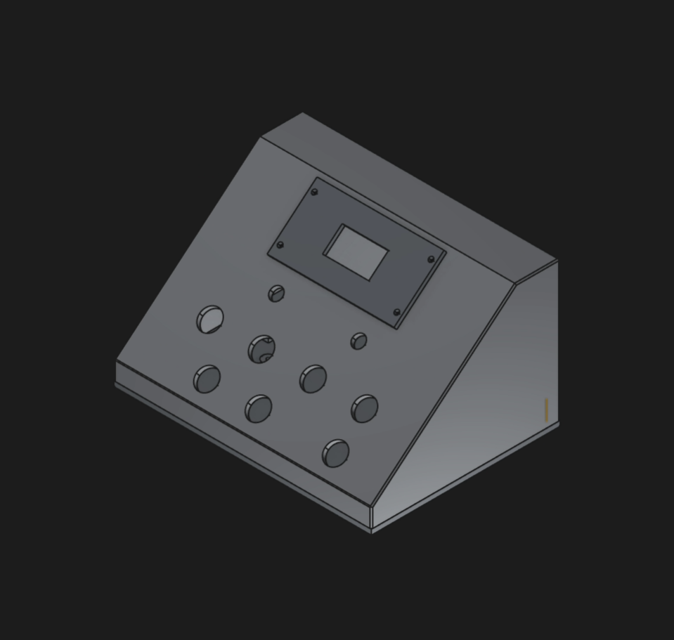
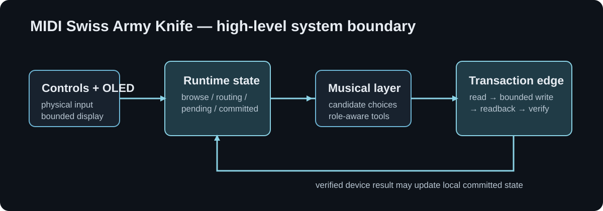
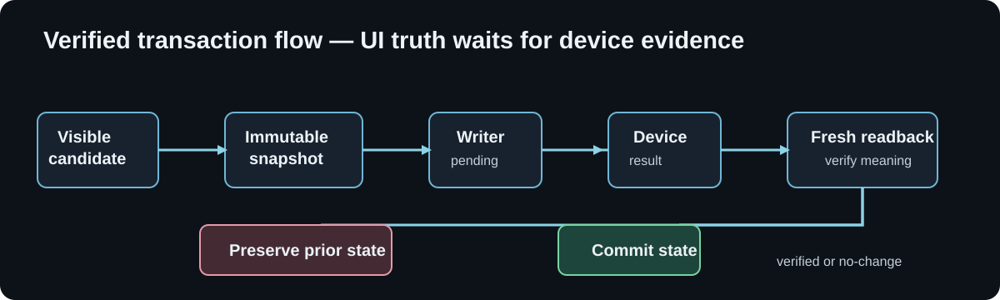

# MIDI Swiss Army Knife

**MIDI Swiss Army Knife** is a personal Teensy-based musical workbench for hands-on Elektron workflows, developed primarily around Digitakt II. It is a command, idea, transformation, and learning layer: it proposes material, keeps state explicit, and leaves musical decisions with the player.

> Knife proposes · the player explores · Digitakt edits

This is a public engineering showcase, not the complete firmware source and not a consumer product release.

## What it explores

- A custom physical instrument surface: encoders, buttons, a 128×64 OLED, DIN MIDI, native USB MIDI, and a Teensy 4.1 controller.
- State-driven embedded interaction for harmony, notes, lines, drums, arpeggiation, and MIX LAB.
- Digitakt II integration approached as a verified state transition—not a fire-and-forget transmission.
- Musical exploration where candidates remain visible and choice remains explicit.

The working system has evolved through source work, host tests, and selected hardware experiments. The evidence labels below are deliberate: **HARDWARE-PROVEN** is not implied by a build, a source reading, or a fixture.

## Hardware and interaction

The firmware is built around a Teensy 4.1, two rotary encoders, direct choice buttons, a dedicated SEND control, and a small SH1106 OLED. DIN MIDI and USB MIDI sit at the transport edge; musical and UI state stay local to the device.



*Early enclosure CAD concept, not a photograph of finished hardware and not a product render.*

The constrained interface is intentional: physical controls expose a small, readable musical surface instead of reproducing a workstation UI. The display reports state; it does not own it.

## Interaction philosophy

The project separates temporary exploration from deliberate commitment:

- browsing is not committing;
- a visible candidate must be the candidate submitted;
- routing state is not claimed device history;
- technical safety can veto an unsafe operation, but musical suitability should annotate rather than silently override the user.

This matters when an embedded controller is both a performance surface and a stateful companion to another instrument.

## Digitakt II: verified transaction thinking

The Digitakt II writer work is framed as a bounded, evidence-driven transaction:

```text
READ → decode → bounded mutation → write → settle → fresh readback
     → byte comparison → semantic verification → committed state
```

Calling a write API is not treated as proof. A verified `NO_CHANGE` can be a valid outcome; a failed or ambiguous verification does not promote speculative UI state to device truth. The implementation distinguishes concepts such as `SET_OK`, verified `NO_CHANGE`, `WRITE_NOT_APPLIED`, `READBACK_MISMATCH`, `SEMANTIC_MISMATCH`, and `STATE_UNKNOWN` as engineering outcomes, not a polished public protocol API.





The public material intentionally omits raw SysEx, object layouts, byte maps, payloads, and writer implementation details.

## Musical tools

Knife explores several bounded musical workspaces:

- **CHORD / HARMONY** — explicit harmonic vocabulary, voicing, flavor, bass choices, and bounded progression suggestions.
- **NOTE / LINE / ARP** — role-aware note choices, phrase-like lane material, timing, gate, and playback ownership.
- **DRUM** — a compact 16-step drum vocabulary and kit-style references.
- **MIX LAB** — a separate experimental drum workspace for role, family, part, candidate, track, and mix-state exploration.

These are aids for exploration, not autonomous composition. The external sequencer remains the source of time and final editing.

## MIX LAB / BUILD A MIX

MIX LAB keeps three kinds of state separate:

```text
browse candidate  ≠  committed CURRENT MIX  ≠  future routing target
```

Its experimental corpus contains role/family/part candidates. BUILD and FREE browse the same role corpus: BUILD marks relationship-relevant families from current context, while FREE removes that advisory bias. Neither mode should conceal technically valid musical options merely because a heuristic dislikes them.

The experiment is deliberately honest about its limits: the candidate research is not a finished ontology, and some musical distinctions still need audition and device-level validation.

## Routing and state management

The central engineering problem is avoiding silent state drift between a live UI, a pending transaction, remembered routing, and physical device state.

- A send uses an immutable snapshot rather than whatever the UI happens to show later.
- Busy and pending states prevent overlapping ownership.
- Device outcomes, not UI optimism, determine committed state.
- Role-to-track memory is separate from browse state.
- Rebinding/unbinding are explicit concepts because a routing decision is meaningful musical context.

## Engineering challenges and lessons

This project has been a practical exercise in making small hardware interfaces tell the truth.

- USB host behavior and session quirks need observation, not assumptions.
- A 128×64 display rewards short labels and well-bounded views; it also forces careful separation of display concerns from runtime state.
- SysEx-facing work needs a strict read → mutate → write → readback discipline to avoid overwriting unrelated device state.
- Causal transaction IDs and immutable snapshots make it possible to distinguish the candidate being browsed from the candidate actually submitted.
- `NO_CHANGE`, failed write application, readback mismatch, and semantic mismatch are materially different states.
- Hardware evidence can overturn a plausible source-level story. That is a feature of the process, not an inconvenience to hide.

## Evidence and current status

| Evidence label | Meaning in this showcase |
| --- | --- |
| **HARDWARE-PROVEN** | Observed on the relevant physical setup. No broader compatibility is implied. |
| **IMPLEMENTED / SOURCE-LEVEL** | Present in the private working firmware source. This is not runtime proof. |
| **TESTED** | Exercised in an appropriate host test or fixture. This is not hardware proof. |
| **EXPERIMENTAL** | Implemented or researched, but still awaiting fuller device and musical validation. |
| **RESEARCH / NOT YET PRODUCTIZED** | Useful design or protocol research that is intentionally not presented as a released capability. |

Digitakt II is the primary integration focus. Syntakt appears only as adjacent control/protocol research and as a source of architectural lessons; it is not presented here as having equivalent support.

## Limitations

- This repository does not contain the complete working firmware, binaries, raw captures, reverse-engineered layouts, or private research corpus.
- It does not claim universal Elektron compatibility, production readiness, or a supported installation path.
- It does not claim that a successful build proves hardware behavior.
- Experimental musical material and device workflows remain subject to audition and hardware validation.

## Repository policy

This public repository contains only safe showcase material: high-level descriptions, original diagrams, and a clearly labelled early enclosure CAD image. It excludes firmware source, device backups, raw MIDI/SysEx data, protocol internals, book-derived material, local paths, identifiers, and credentials.

No software license has been added. The repository is documentation and portfolio material, not an open-source firmware release.

See [the technical overview](docs/technical-overview.md) for a compact architectural map and [the evidence notes](docs/evidence-and-scope.md) for the public/private boundary.
